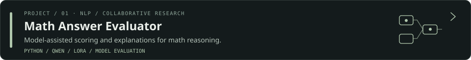
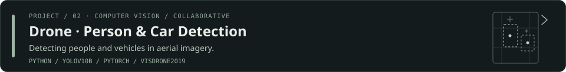
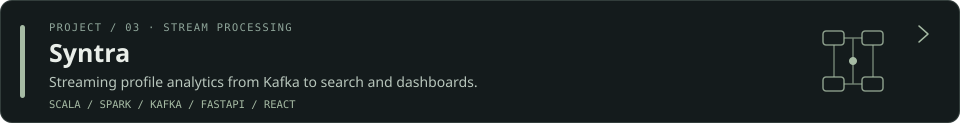
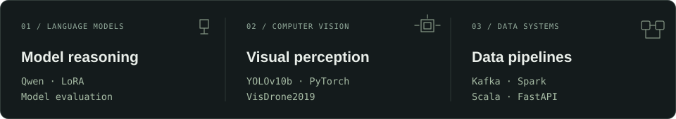

<!-- Quiet Signal — AI edition, tailored for Mohammad Ismail -->

  

01 / ABOUT

I work at the intersection of language models, computer vision, and the systems behind applied AI. Interested in evaluating models carefully and building things that work beyond the notebook.

The dream is full-stack, the reality is debugging.

02 / SELECTED WORK

Collaborative project · Related work is under the <code>mohammad/</code> directory.

Collaborative project · Technical decision-making and guidance within a two-person team.

03 / AREAS & TOOLS

Curious about models. Careful with systems.
